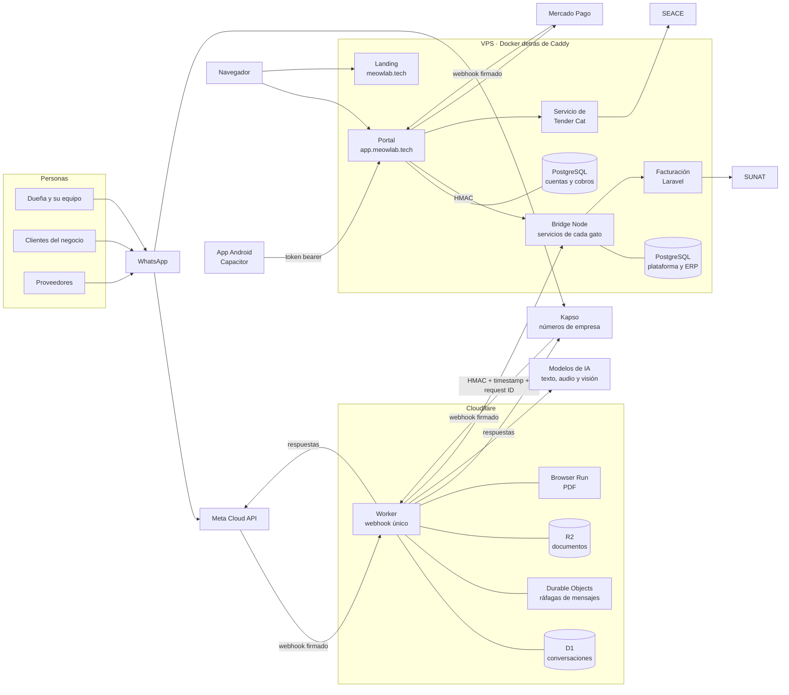

# MeowLab

MeowLab le da a las **mypes peruanas** un equipo de agentes de IA, los **gatos**, que
trabajan dentro de **WhatsApp**. La dueña del negocio les escribe en **un solo chat**,
como a alguien de su equipo, y el gato que corresponde hace el trabajo: factura,
vende, controla el stock, cobra, repone y atiende a los clientes. Lo importante lo
confirma ella con un botón. El resumen y la configuración están en el portal
[app.meowlab.tech](https://app.meowlab.tech).

Este repositorio reúne la landing, la plataforma conversacional, el portal y la app
Android. Cada aplicación tiene sus propias dependencias, secretos y despliegue.

> **Antes de tocar código**, lee [`AGENTS.md`](AGENTS.md) (reglas y enrutamiento por
> tipo de tarea) y [`docs/project/status.md`](docs/project/status.md) (qué está
> desplegado de verdad).

---

## Los gatos

| Gato | Qué hace | Precio al mes (con IGV) | Rol en el código | Decisión |
| --- | --- | --- | --- | --- |
| **Invoice Cat** | Facturas, boletas, notas de crédito y guías de remisión ante SUNAT | S/ 39 | `enterprise-advisor` | [0005](docs/decisions/0005-modelo-interpreta-facturacion.md) |
| **Tender Cat** | Licitaciones del Estado (SEACE) que encajan con el negocio, con sus bases y su expediente | S/ 35 | `radar` | [0003](docs/decisions/0003-radar-rol-licitaciones.md) |
| **Sales Cat** | Ventas y cotizaciones en PDF; es la cara del negocio ante el cliente | S/ 59 | `sales` | [0011](docs/decisions/0011-sales-cat.md) |
| **Stock Cat** | Inventario y alertas de mínimo; el stock baja con los comprobantes | S/ 29 | `stock` | [0014](docs/decisions/0014-stock-cat.md) |
| **Collections Cat** | Lo que le deben a la empresa: recordatorios y validación de pagos | S/ 25 | `collections` | [0015](docs/decisions/0015-collections-cat.md) |
| **Reorder Cat** | Propone reponer lo que se acaba y le pide al proveedor | S/ 25 | `reorder` | [0016](docs/decisions/0016-reorder-cat.md) |
| **Support Cat** | Postventa 24/7 en el WhatsApp de la empresa | S/ 39 | `support` | [0017](docs/decisions/0017-support-cat.md) |

**Descuentos por cantidad de gatos:**
- 10 % con 2;
- 15 % con 3 o 4;
- 20 % con 5 o más.

Qué hace cada gato con el cliente, con la dueña y con el proveedor (proactivo,
reactivo o consultado) está en la
[matriz de participación](docs/project/matriz-participacion.md).

**Nombres internos.** El código conserva nombres anteriores a la marca única:
- **«Manolo»** es la plataforma de WhatsApp (`apps/manolo-whatsapp-worker`);
- **«RADAR»** es el motor de Tender Cat;
- **«FacturaYa»** es el servicio de facturación electrónica (repositorio aparte,
  `facturaya-ai`).

Hacia los usuarios todo se llama **MeowLab** y sus gatos.

---

## Arquitectura



### Componentes

| Componente | Dónde está | Tecnología | Dónde corre |
| --- | --- | --- | --- |
| **Landing** | [`src/`](src), [`public/`](public) | Astro 5, Tailwind | VPS, contenedor `meowlab-web` |
| **Worker** (gateway de WhatsApp) | [`apps/manolo-whatsapp-worker`](apps/manolo-whatsapp-worker) | TypeScript, Cloudflare Workers, D1, R2, Durable Objects, Browser Run | Cloudflare |
| **Bridge** (servicios de los gatos) | [`apps/manolo-whatsapp-worker/src/node`](apps/manolo-whatsapp-worker/src/node) | Node, PostgreSQL | VPS, contenedor `manolo-platform-bridge-1` |
| **Portal** | [`apps/meowlab-app`](apps/meowlab-app) | Hono, React 19, Vite, Tailwind 4, better-auth | VPS, contenedor `meowlab-app` |
| **App Android** | [`apps/meowlab-mobile`](apps/meowlab-mobile) | Capacitor sobre el portal | Celular (aún sin publicar) |
| **Facturación electrónica** | repositorio `facturaya-ai` | Laravel, PHP 8.4, Greenter | VPS, contenedores `facturaya-ai-*` |
| **Servicio de Tender Cat** | ramas `feat/tender-*` (en proceso de fusión) | Node | VPS, contenedor `meowlab-app-tender-service-1` |

### Cómo viaja un mensaje

1. **Entrada:** la dueña, un cliente o un proveedor escribe por WhatsApp. Meta avisa al
   Worker en Cloudflare; para los números de empresa conectados por Kapso, Kapso
   reenvía el mismo aviso firmado al mismo Worker.
2. **Verificación y respuesta rápida:** el Worker comprueba la firma del webhook,
   responde `200` de inmediato y sigue procesando en segundo plano.
3. **Normalización:**
   - convierte audio, imagen y documento en contexto para el gato;
   - agrupa en un solo turno los mensajes que llegan seguidos (Durable Objects);
   - descarta duplicados con el ID de Meta.
4. **Elección del gato:**
   - el Worker pregunta al bridge qué gato corresponde según el contacto, su
     empresa y lo que tiene activo;
   - los comandos (`/sales`, `/stock`, `/collections`…) eligen gato directamente.
5. **Trabajo del gato:**
   - interpreta con IA y arma un borrador;
   - lo importante lo muestra para confirmar con botones;
   - al confirmar, la operación se hace en el **bridge**, con la firma HMAC del
     cuerpo, el timestamp y un request ID que la vuelve idempotente.
6. **Datos de negocio:** el bridge guarda en PostgreSQL y, si hace falta, llama a
   la facturación electrónica, que emite ante SUNAT.
7. **Respuesta y portal:**
   - la respuesta vuelve por la API de WhatsApp;
   - el portal muestra lo mismo a la dueña: resumen de la semana, pendientes,
     actividad de los gatos y la ficha de cada uno.

### Dónde vive cada dato

| Dato | Fuente de verdad |
| --- | --- |
| Transporte de WhatsApp, conversaciones y deduplicación | D1 (Cloudflare) |
| Contactos, empresas, membresías, roles y permisos | PostgreSQL del VPS (esquema `whatsapp`) |
| Clientes y productos compartidos | PostgreSQL, esquema `commerce` |
| Ventas y cotizaciones | PostgreSQL, esquema `sales` |
| Inventario y movimientos | PostgreSQL, esquema `stock` |
| Deudas, pagos y recordatorios | PostgreSQL, esquema `receivables` |
| Pedidos a proveedores | PostgreSQL, esquema `purchasing` |
| Casos de clientes y preguntas frecuentes | PostgreSQL, esquema `support` |
| Comprobantes electrónicos, XML y constancias de SUNAT | Servicio de facturación |
| Cuentas del portal, catálogo de precios y suscripciones | PostgreSQL del portal (`meowlab_app`) |
| Documentos temporales y PDF | R2 |

El modelo de datos de la plataforma como ERP (un esquema por dominio, clientes
compartidos) está en la decisión [0008](docs/decisions/0008-modelo-de-datos-erp.md).
D1 sigue siendo la fuente de las conversaciones: su retiro a favor de PostgreSQL
requiere un corte explícito y verificable
([arquitectura actual](docs/architecture/current-system.md)).

### Límites de confianza

- **Un solo receptor de WhatsApp:** el Worker. Recibe el webhook de Meta (`/webhooks/whatsapp`) y el reenvío firmado de Kapso (`/webhooks/kapso`). El VPS no recibe tráfico de WhatsApp.
- **Rutas privadas firmadas:** toda llamada del Worker o del portal al bridge lleva
  firma HMAC del cuerpo exacto, un timestamp con ventana corta y un request ID. Sin
  firma no hay ruta.
- **PostgreSQL no se expone a internet.** Caddy es la única entrada al VPS; la
  administración va por SSH.
- **Aislamiento por empresa (tenant):** cada consulta filtra por empresa y cada
  operación verifica que el contacto o el usuario pertenezca a ella.
- **Secretos:** Cloudflare Secrets para el Worker y Docker Secrets para el VPS.
  Nunca van en el repositorio (`.env`, `.dev.vars` y `secrets/` están ignorados).
- **Los gatos dependen de contratos:** un gato no conoce las credenciales ni la
  implementación HTTP de Meta, de los modelos de IA ni de la facturación.

### Portal y cobros

- **Qué es el portal:** [app.meowlab.tech](https://app.meowlab.tech) es una SPA en
  React servida por Hono en Node.
- **Inicio de sesión:** better-auth, con cookies en la web y token bearer en la app
  Android.
- **Qué se ve:**
  - el Inicio («Para atender», «Tus gatos hoy», tendencia de 14 días y actividad);
  - la ficha de cada gato;
  - el Plan;
  - el Negocio (empresas, equipo e invitaciones).
- **Cobro mensual:** con **Mercado Pago** (suscripciones `preapproval`), en
  producción desde el 20/11/2026.
  - El webhook de Mercado Pago llega firmado.
  - El portal vuelve a consultar el cobro antes de acreditar un mes, que se
    registra una sola vez por pago.
  - Al pagar, el portal pide al bridge activar el gato hasta el fin del periodo.
  - Diseño en la decisión [0007](docs/decisions/0007-cobros-mercado-pago-y-yape.md).

### Decisiones de arquitectura

Las decisiones duraderas están en [`docs/decisions/`](docs/decisions/README.md),
una por archivo. Las más importantes para entender el sistema:

| Decisión | Tema |
| --- | --- |
| [0002](docs/decisions/0002-agrupar-rafagas-whatsapp.md) y [0004](docs/decisions/0004-rafagas-texto-imagen.md) | Mensajes seguidos y fotos en un solo turno |
| [0006](docs/decisions/0006-portal-app-meowlab.md) | El portal app.meowlab.tech |
| [0007](docs/decisions/0007-cobros-mercado-pago-y-yape.md) | Cobros con Mercado Pago y Yape |
| [0008](docs/decisions/0008-modelo-de-datos-erp.md) | La plataforma como ERP: un esquema por dominio |
| [0009](docs/decisions/0009-kapso-proveedor-de-numeros.md) | Kapso como proveedor de números de empresa |
| [0010](docs/decisions/0010-empresas-e-invitaciones-en-el-portal.md) | Empresas e invitaciones |
| [0011](docs/decisions/0011-sales-cat.md) a [0017](docs/decisions/0017-support-cat.md) | Cada gato |
| [0018](docs/decisions/0018-app-movil-android-capacitor.md) | App Android con Capacitor |

---

## Estructura del repositorio

```text
meowlab/
├─ src/, public/                  Landing (Astro)
├─ apps/
│  ├─ manolo-whatsapp-worker/     Worker de Cloudflare y bridge Node del VPS
│  │  ├─ src/                     Worker: webhook, normalización, roles (gatos), adaptadores
│  │  ├─ src/node/                Bridge: servicios por gato, portal, facturación, seguridad
│  │  ├─ migrations/              Migraciones D1
│  │  ├─ infra/postgres/          Migraciones de PostgreSQL del bridge
│  │  ├─ infra/vps/               Docker, Caddy y scripts de release del bridge
│  │  └─ test/                    Pruebas (Vitest con el pool de Workers)
│  ├─ meowlab-app/                Portal: server/ (Hono), web/ (React), migraciones del portal
│  └─ meowlab-mobile/             App Android (Capacitor) que empaqueta el portal
├─ docs/
│  ├─ architecture/               Arquitectura actual y borradores
│  ├─ decisions/                  Decisiones de arquitectura (ADR)
│  ├─ operations/                 Actas de despliegue, con rollback
│  ├─ project/                    Estado, tablero y matriz de participación
│  └─ agents/                     Tareas y reglas para los agentes de desarrollo
└─ tools/board/                   Generador del tablero (board.json → board.html)
```

---

## Desarrollo local

Cada aplicación se instala y se prueba por separado.

**Landing** (en la raíz; usa pnpm):

```powershell
pnpm install
pnpm dev        # servidor de desarrollo
pnpm check      # astro check
pnpm test       # Vitest
pnpm build
```

**Worker y bridge:**

```powershell
cd apps/manolo-whatsapp-worker
npm ci
npm test               # necesita .dev.vars local (no versionado)
npx tsc --noEmit
npm run build:node     # bridge para el VPS
```

**Portal:**

```powershell
cd apps/meowlab-app
npm ci
npm test
npm run typecheck
npm run dev            # build + wrangler dev con D1 local
```

**App Android:** requisitos y comandos en
[`apps/meowlab-mobile/README.md`](apps/meowlab-mobile/README.md).

La validación que corresponde a cada tipo de cambio está en
[`docs/development/validation.md`](docs/development/validation.md).

---

## Despliegue

**Todo lo que se despliega sale de un commit publicado en `origin`.** No se despliega
desde cambios sin commitear, desde `backups/` ni desde bundles parcheados. Cada
despliegue deja un acta en [`docs/operations/`](docs/operations) con el hash, las
comprobaciones y el rollback. La regla completa está en [`AGENTS.md`](AGENTS.md).

| Aplicación | Cómo se despliega |
| --- | --- |
| Landing | Imagen Docker construida en el VPS con [`Dockerfile.deploy`](Dockerfile.deploy) desde `git archive` del commit; contenedor `meowlab-web` |
| Worker | `wrangler deploy --env production` desde el commit publicado |
| Bridge | Release en `/opt/manolo-platform/releases/<id>` con [`stage-bridge-release.sh`](apps/manolo-whatsapp-worker/infra/vps/stage-bridge-release.sh), con cutover y rollback |
| Portal | Imagen `meowlab-app:<commit>` y `docker compose` en `/opt/meowlab-app/deploy` |
| Facturación | Release con cutover y rollback en el VPS (repositorio `facturaya-ai`) |

Procedimientos detallados en [`docs/operations/deployment.md`](docs/operations/deployment.md).

---

## Documentación

- [`docs/README.md`](docs/README.md): índice de la documentación técnica.
- [`docs/project/status.md`](docs/project/status.md): qué está desplegado y qué falta.
- [`docs/project/board.html`](docs/project/board.html): tablero de tareas, generado
  desde `board.json`.
- [`docs/architecture/current-system.md`](docs/architecture/current-system.md):
  arquitectura detallada del canal de WhatsApp.
- [`docs/apps/`](docs/apps): guías por aplicación (landing, plataforma, Tender Cat).

© 2026 MeowLab.
