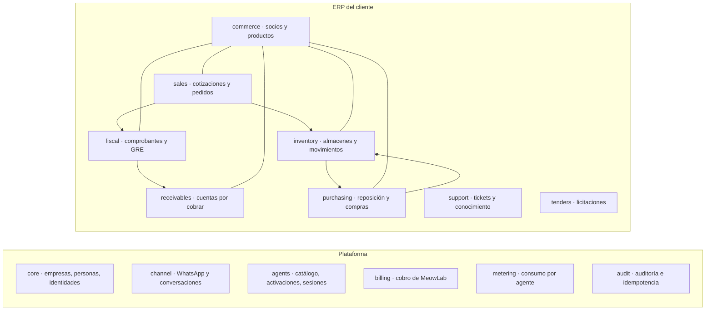
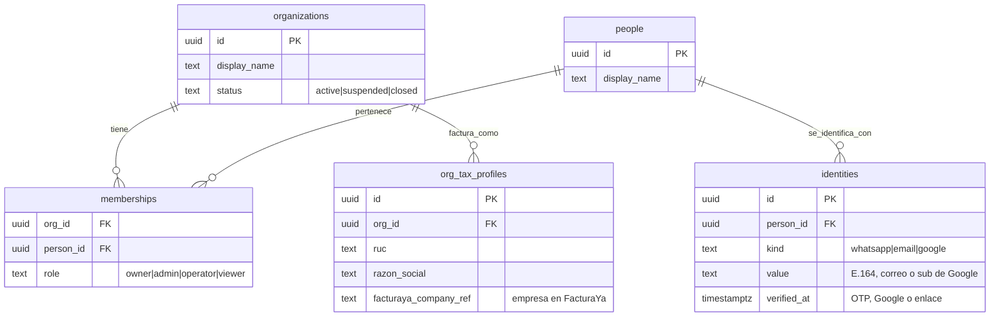
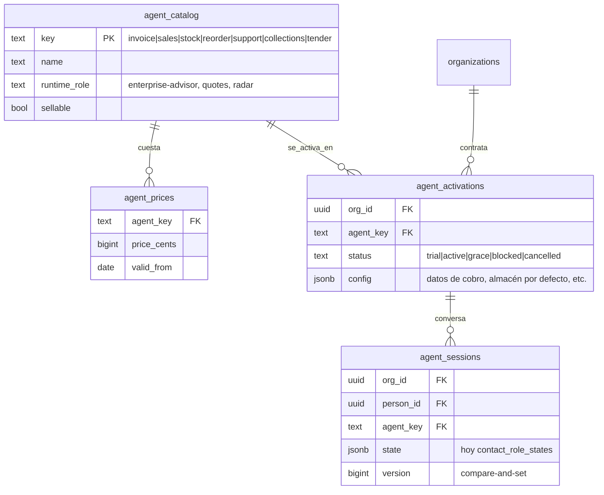
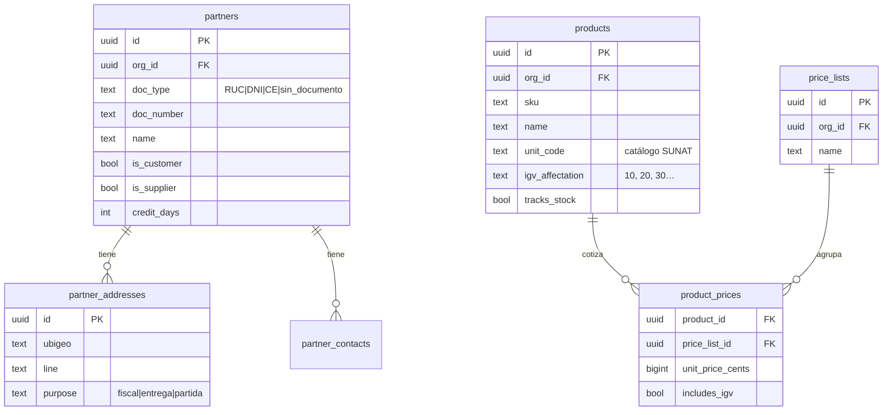
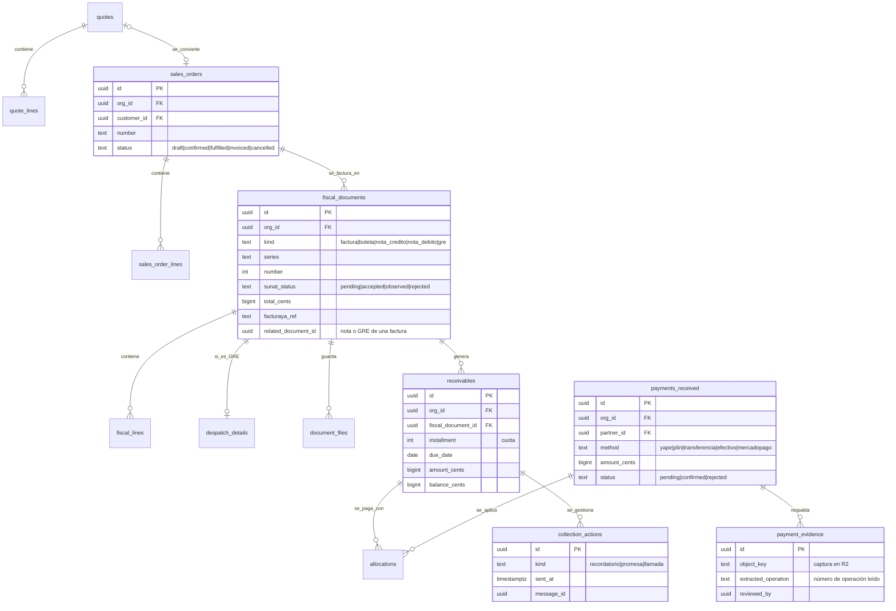
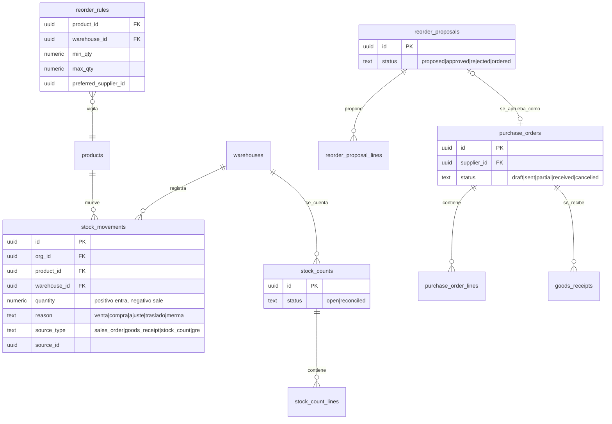

# Modelo de datos de MeowLab como ERP — borrador

- Estado: **borrador para discusión** (2026-11-12). No hay migraciones ni código.
- Base: los seis agentes del informe ejecutivo 2027–2029, RADAR y la
  infraestructura que ya corre (Manolo, bridge, portal, FacturaYa).
- Cuando se acuerde, se convierte en un ADR y en migraciones por fase.

## 1. Idea central

MeowLab no es un conjunto de bots sueltos: es **un ERP pequeño con agentes como
interfaz**. Cada agente es una forma de leer y escribir en módulos compartidos, no
un dueño de sus propios datos. Así, Sales Cat crea un pedido, Invoice Cat lo factura,
Stock Cat descuenta el inventario, Reorder Cat propone la compra, Collections Cat
cobra la factura y Support Cat atiende al cliente, **sobre los mismos clientes,
productos y documentos**.

| Agente | Precio | Módulo que opera | Lee además |
| --- | --- | --- | --- |
| Invoice Cat | S/ 39 | `fiscal` | `commerce`, `sales` |
| Sales Cat | S/ 59 | `sales` | `commerce`, `inventory` (disponibilidad) |
| Stock Cat | S/ 29 | `inventory` | `commerce` |
| Reorder Cat | S/ 25 | `purchasing` | `inventory`, `sales` (demanda) |
| Support Cat | S/ 39 | `support` | todos, sólo lectura |
| Collections Cat | S/ 25 | `receivables` | `fiscal`, `commerce` |
| **Tender Cat** (hoy RADAR) | por definir | `tenders` | `sales` (cotizar una licitación) |

**Nombre para RADAR: «Tender Cat».** Sigue la convención «<oficio> Cat» del
catálogo y *tender* es licitación en inglés comercial. Alternativas: «Bid Cat» (más
corto) o «Licita Cat» (más claro en español, rompe la convención en inglés). RADAR
puede quedar como nombre de la aplicación de escritorio.

## 2. Reglas transversales

1. **Un PostgreSQL, un esquema por módulo.** Los límites de los módulos son límites
   de esquema; los permisos se otorgan por esquema (como ya se hizo con
   `print_system` y el rol de sólo lectura del asesor).
2. **Todo dato de negocio lleva `org_id`.** Las llaves foráneas entre tablas de
   negocio son compuestas `(org_id, id)`: es imposible, por construcción, que un
   pedido de una empresa apunte al cliente de otra. Además, Row Level Security con
   `current_setting('app.org_id')`.
3. **Dinero en céntimos (`bigint`) y moneda explícita.** IGV por línea con su
   afectación SUNAT (gravado, exonerado, inafecto). Nunca `float`.
4. **Libros inmutables.** Movimientos de inventario, pagos recibidos y eventos de
   auditoría sólo se insertan; los saldos se derivan. Los comprobantes aceptados por
   SUNAT no se editan: se corrigen con notas.
5. **Identificadores** `uuid` (v7, ordenables en el tiempo) en tablas nuevas;
   correlativos humanos (serie-número, número de pedido) como columnas aparte, únicas
   por empresa.
6. **Estados explícitos** con `CHECK`, `created_at`/`updated_at` en `timestamptz` y
   `archived_at` en lugar de borrar.
7. **Idempotencia** por `(org_id, idempotency_key)` en toda operación que un agente
   pueda reintentar (la deduplicación de Meta y los botones ya lo exigen hoy).
8. **Origen del dato.** Las filas creadas por un agente guardan `source_agent`,
   `source_message_id` y `created_by_person_id`: se puede responder «quién lo pidió y
   en qué mensaje».

## 3. Plataforma

### 3.1 `core`: empresas, personas e identidades

Hoy la identidad está repartida: contacto de WhatsApp (`whatsapp.contacts`), cuenta
del portal (`meowlab_app.user`) y empresa de FacturaYa (`tenant_members`). El modelo
las une en **persona**, **identidades** y **membresías**.

- `identities(kind, value)` es único: un número de WhatsApp pertenece a una sola
  persona. La vinculación por OTP del portal (ADR-0006) se convierte en «verificar
  una identidad `whatsapp` de la persona».
- Una persona puede pertenecer a varias empresas (contador con varios clientes); la
  empresa activa de la conversación vive en la sesión del agente.

### 3.2 `channel`: canales y conversaciones

`whatsapp_numbers` (número de Meta → empresa dueña), `conversations` (persona ×
número), `messages` (entrantes y salientes, con `meta_message_id` único para la
deduplicación) y `outbox` (mensajes por enviar con reintentos). Equivale a lo que hoy
está en D1 y en `whatsapp.*`; la migración de D1 a PostgreSQL ya está planeada.

### 3.3 `agents`: catálogo, activaciones y sesiones

`agent_activations.status` es lo que consulta el bridge para el bloqueo por impago
(ADR-0007, fase 2). Los precios tienen vigencia: cambiar una tarifa no reescribe la
historia de lo cobrado.

### 3.4 `billing`: lo que MeowLab le cobra a sus clientes

Generaliza la migración `0003_billing.sql` del portal: la suscripción pasa de la
cuenta del portal a la **empresa**.

- `subscriptions` (empresa, proveedor, `provider_ref`, estado, `paid_until`),
  `subscription_items` (agentes incluidos y su precio congelado), `discount_tiers`.
- `payments` (único por proveedor y referencia; concede un periodo) y
  `payment_claims` (capturas de Yape pendientes de aprobación).
- **Collections Cat sobre MeowLab:** MeowLab es una empresa más dentro del sistema.
  Las cuotas de sus suscripciones se reflejan como cuentas por cobrar en *su propio*
  módulo `receivables`, y Collections Cat las cobra igual que lo haría para cualquier
  comercio. `billing` es la regla de negocio de la plataforma; `receivables` es la
  herramienta del ERP.

### 3.5 `metering` y `audit`

- `metering.usage_events`: empresa, agente, tipo (`ai_tokens`, `meta_template`,
  `meta_message`, `pdf_render`, `sunat_call`), cantidad, costo estimado en céntimos.
  El informe pide medir costo por documento y por agente; hoy no se registra.
- `audit.events` (quién, qué, cuándo, sobre qué entidad, desde qué mensaje) e
  `audit.idempotency_keys`.

## 4. ERP del cliente

### 4.1 `commerce`: datos maestros compartidos

Un mismo socio puede ser cliente y proveedor. `(org_id, doc_type, doc_number)` es
único cuando hay documento. Las direcciones con ubigeo sirven igual a la factura y a
la guía de remisión.

### 4.2 `sales` (Sales Cat), `fiscal` (Invoice Cat) y `receivables` (Collections Cat)

- **FacturaYa sigue siendo el motor fiscal** (firma, envío a SUNAT, CDR). `fiscal`
  es el reflejo consultable para el ERP y el portal (fase 3 del ADR-0006): cada fila
  apunta a su `facturaya_ref` y se actualiza desde FacturaYa, nunca al revés.
- Las cuotas que ya se cargan en la factura (forma de pago a crédito) se convierten en
  `receivables`. Un pago se reparte entre varias deudas con `allocations`.
- **Collections Cat** trabaja aquí: una captura crea `payments_received` en
  `pending` con su `payment_evidence`; sólo una persona o una conciliación confiable
  la pasa a `confirmed`. Es la misma regla que ya se fijó para Yape en ADR-0007.
- Las cotizaciones en PDF de hoy (`quote_drafts`, `quote_items`) migran a `quotes`.

### 4.3 `inventory` (Stock Cat) y `purchasing` (Reorder Cat)

- El stock es la suma de `stock_movements` (con una vista materializada
  `stock_balances` para leer rápido). Una venta, una recepción, un conteo o una GRE
  generan movimientos; nadie «edita el stock».
- **Stock Cat** concilia: un conteo crea `stock_count_lines` y la diferencia se
  registra como movimiento `ajuste`, con quién lo aprobó.
- **Reorder Cat** sólo **propone**: compara `stock_balances` con `reorder_rules` y la
  demanda reciente de `sales`. Una persona aprueba y recién entonces existe la orden
  de compra (mismo principio que «la IA no emite sin botón»).

### 4.4 `support` (Support Cat) y `tenders` (Tender Cat)

- `support`: `tickets` (cliente, canal, estado, prioridad, asignado a),
  `ticket_events` (mensajes y cambios, enlazados a `channel.messages`),
  `knowledge_articles` (preguntas frecuentes de cada empresa, con versión) y
  `escalations` (cuando el agente deriva a una persona).
- `tenders`: `tender_notices` (OCID, entidad, objeto, monto, plazos; compartidos entre
  empresas porque son públicos), `tender_matches` (aviso × empresa, con puntaje y
  motivo), `tender_selections` (interesa / descartado, hoy `radar_*_selections`) y
  `tender_bids` (preparación de la propuesta; puede generar una cotización en
  `sales.quotes`). Las tablas `radar_*` actuales se migran aquí.

## 5. De dónde viene cada cosa hoy

| Hoy | Destino |
| --- | --- |
| `whatsapp.tenants`, `tenant_members`, `whatsapp.contacts`, `meowlab_app.user` | `core` (empresas, personas, identidades, membresías) |
| `whatsapp.role_catalog`, `contact_role_states`, `bot_configs` | `agents` |
| D1 `conversations`/`messages`, `whatsapp.conversations`/`messages` | `channel` |
| D1 y `whatsapp.quote_*` | `sales.quotes` |
| FacturaYa (`invoices`, `credit_notes`, `despatches`, `customers`) | `fiscal` (reflejo) y `commerce.partners` |
| `whatsapp.radar_*` | `tenders` |
| `meowlab_app.billing_*` | `billing` |
| `print_system.*` (imprenta del asesor) | datos de una empresa en `commerce`, `sales` y `purchasing` |

## 6. Orden sugerido

1. `core` + `agents`: unificar identidad y activaciones (lo necesitan el bloqueo por
   impago y la fase 3 del portal).
2. `commerce` + `fiscal` (reflejo de FacturaYa) + `receivables`: Invoice Cat y
   Collections Cat, que son lo que ya se vende y cobra.
3. `sales`: Sales Cat (está en pruebas).
4. `inventory` y `purchasing`: Stock y Reorder Cat.
5. `support` y la migración de `tenders`.

## 7. Preguntas abiertas

- ¿El ERP es la fuente de verdad de clientes y productos, o FacturaYa sigue siéndolo
  para lo fiscal? (Propuesta: el ERP para todo; FacturaYa recibe copias al emitir.)
- ¿Se permite stock negativo (vender sin existencias registradas)?
- ¿Varias monedas (USD) desde el inicio o sólo PEN?
- ¿Cuántos almacenes y listas de precios por empresa en el primer corte?
- ¿Tender Cat se vende como agente del catálogo y a qué precio?
- ¿Las personas de una empresa ven todos sus datos o hay permisos por módulo?
