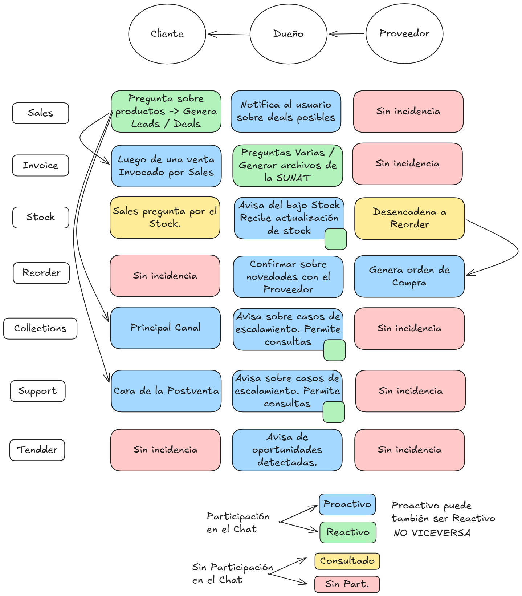

# Matriz de participación de los gatos

Fecha: 16/11/2026.

Es la visión del operador: el caso de uso principal de cada gato con cada actor del
sistema (cliente, dueño y proveedor). Sirve de guía para priorizar fases, escribir
los textos de la landing y decidir funciones nuevas. **No describe lo que ya está
construido.** Para eso, consulta [`status.md`](status.md) y las ADR de cada gato
(0011 a 0017).

## Tipos de participación

| Tipo | Significado |
| --- | --- |
| **Proactivo** | El gato inicia la conversación en el chat con ese actor. Un gato proactivo también puede ser reactivo, pero no al revés. |
| **Reactivo** | El gato solo responde cuando el actor le escribe. |
| **Consultado** | El gato no participa en el chat con ese actor. Otro gato le pregunta algo. |
| **Sin participación** | El gato no tiene relación con ese actor. |

## La matriz

| Gato | Cliente | Dueño | Proveedor |
| --- | --- | --- | --- |
| Sales | **Reactivo**: el cliente pregunta por productos y Sales genera leads y oportunidades de venta | **Proactivo**: avisa al dueño de posibles ventas | Sin participación |
| Invoice | **Proactivo**: después de una venta, invocado por Sales | **Reactivo**: preguntas varias y documentos ante SUNAT | Sin participación |
| Stock | **Consultado**: Sales le pregunta por el stock | **Proactivo y reactivo**: avisa del stock bajo y recibe las actualizaciones de stock | **Consultado**: dispara a Reorder |
| Reorder | Sin participación | **Proactivo**: confirma con el dueño las novedades del proveedor | **Proactivo**: genera la orden de compra |
| Collections | **Proactivo**: es el canal principal de cobro | **Proactivo y reactivo**: avisa de los casos escalados y responde consultas | Sin participación |
| Support | **Proactivo**: es la cara de la postventa | **Proactivo y reactivo**: avisa de los casos escalados y responde consultas | Sin participación |
| Tender | Sin participación | **Proactivo**: avisa de las oportunidades detectadas | Sin participación |

Flujos entre gatos:

- **Del lado del cliente**, Sales atiende antes de la venta y después le pasa el
  cliente a Invoice (el comprobante), Collections (el cobro) y Support (la postventa).
- **Del lado del proveedor**, Stock dispara a Reorder.

## Distancia con lo construido (16/11/2026)

| Casilla | Hoy | Dónde está previsto |
| --- | --- | --- |
| Sales con el cliente y avisos de posibles ventas al dueño | El cliente recibe la cotización a través de Support Cat, que usa el catálogo de Sales. No puede confirmar la venta ni pagar en el chat. | ADR-0011, fase 2 |
| Invoice con el cliente, después de la venta | El PDF del comprobante le llega al dueño, no al cliente. | Sin fase asignada |
| Stock consultado al cotizarle al cliente | La cotización al cliente no revisa el stock. | ADR-0011, fase 2 (por definir) |
| Collections proactivo con el cliente | Prepara el recordatorio y el dueño lo envía con un botón. | ADR-0015, fase 2 (plantillas) |
| Support proactivo con el cliente | Solo responde. | ADR-0017, fase 2 (plantillas) |

El resto de las casillas coincide con lo que está en producción:

- Invoice responde al dueño.
- Stock avisa al dueño, recibe actualizaciones y dispara a Reorder.
- Reorder trabaja con el proveedor y con el dueño.
- Collections y Support escalan al dueño y le responden.
- Tender avisa de oportunidades.

En la landing, cualquier casilla pendiente que se muestre lleva la etiqueta
«Próximamente». Por ahora solo se muestra el paso de Sales Cat
([`docs/apps/landing.md`](../apps/landing.md)).
